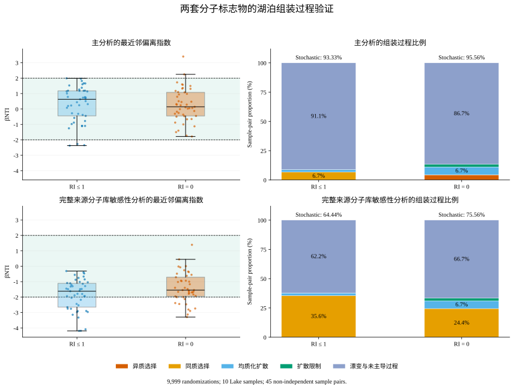

# 两套 DON marker 在 Lake 中的保守性验证

**[下载验证结果Excel](https://github.com/wd475prgfg-cmyk/DON/raw/refs/heads/main/DON_results/marker_lake_conservatism/DON_marker_lake_conservatism.xlsx)** · [下载完整结果、树、零模型分布及代码](https://github.com/wd475prgfg-cmyk/DON/raw/refs/heads/main/DON_results/marker_lake_conservatism/DON_two_marker_conservatism_results.zip) · [详细方法与结果](详细方法与结果.md)

按Mao等WR文章§2.3.2、§3.3及Danczak公开代码的定义，分别对RI≤1、RI=0 marker构建MCD并计算βMNTD、βNTI、RCBray。每套10个Lake样本、45个不重复样本对，各指标9,999次随机化。计算采用Python实现，未把与R随机数序列逐次一致当作复现要求。

## 汇总

| marker集 | 来源候选总数 | Lake检出 | 主分析随机过程 | 完整来源库敏感性随机过程 |
| --- | ---: | ---: | ---: | ---: |
| RI≤1 | 726 | 173 | 42/45，93.33% | 29/45，64.44% |
| RI=0 | 484 | 101 | 43/45，95.56% | 34/45，75.56% |

主分析仅置换Lake实际检出marker的树标签；敏感性分析允许从完整来源marker库置换。两者使用同一完整来源MCD特征尺度与树，观察值不变。RCBray按Lake检出频率加权，共用相同的9,999次结果。

**两套marker集合在两种分子库下均以随机过程为主，为整体相对保守性提供支持；百分比依赖零模型分子库设定。** 这些比例是样本对组装过程的比例，不是某个百分比的单分子“验证通过”，也不证明任何分子绝对不可降解。45个样本对不相互独立，未据两套小幅差异宣称显著优劣。

MCD只对分子特征做Z标准化；峰强未归一化，零模型使用0/1检出矩阵。P在两套库中均为常数0，删除该零方差特征。完整方法、公式、分子库假设、软件版本与种子均已记录；未获得原文补充材料，不能声称严格逐项复现全文。

## 图表

[下载保守性对比SVG](https://github.com/wd475prgfg-cmyk/DON/raw/refs/heads/main/DON_results/marker_lake_conservatism/conservatism_comparison.svg) · [下载βNTI/RCBray热图SVG](https://github.com/wd475prgfg-cmyk/DON/raw/refs/heads/main/DON_results/marker_lake_conservatism/betaNTI_RCBray_heatmaps.svg)

SVG为可编辑矢量文字，指定中文宋体SimSun、英文及数字Times New Roman，不嵌入字体，查看电脑需安装相应字体。

## 核对与边界情况

所有180条“marker集×分子库×样本对”结果从保存的9,999次零模型分布重算一致；Newick树独立解析距离、加权不放回抽样的小型精确概率、观察和随机βMNTD的独立逐对实现、RCBray与汇总均通过核对。

RI≤1的DC10–DC8 βNTI约1.99058接近2；RI=0的DC3–DC9 RC约−0.950995、DC4–DC7约0.954295接近±0.95，有限随机化可能影响临界分类。使用未四舍五入数值判定，并提供Monte Carlo标准误及999/1999/4999/9999次收敛对照。该Monte Carlo区间不是生态学置信区间。

下一步可据这份组装验证，继续评估分子属性的来源区分能力；本次尚未开始RF、XGBoost/SHAP或MixSIAR贡献估计。
